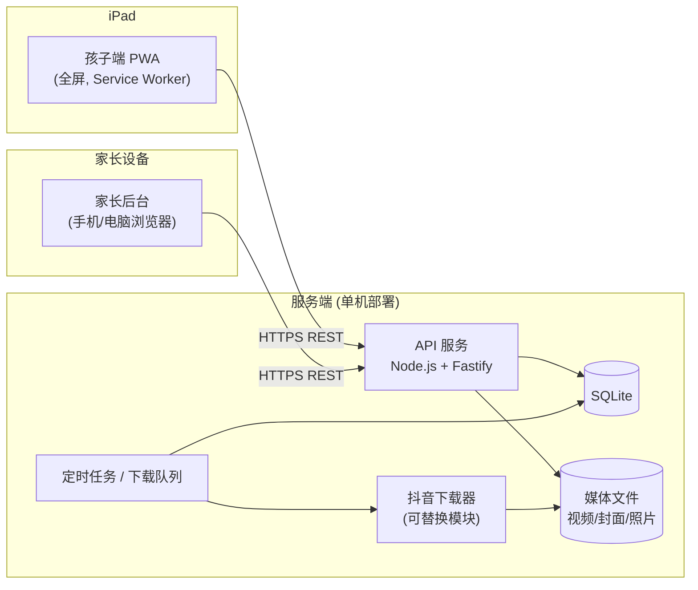
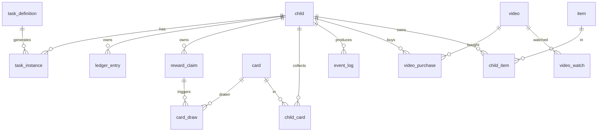
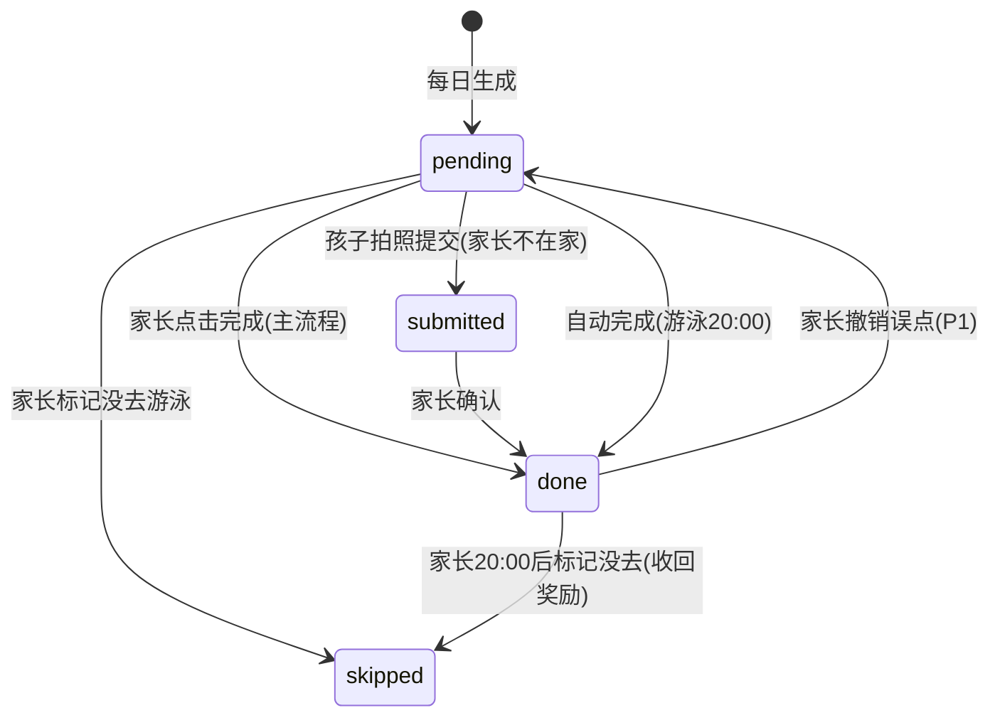
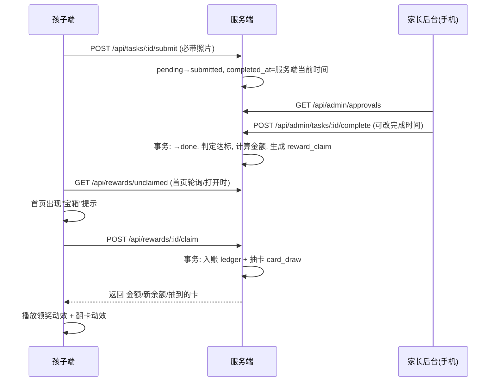
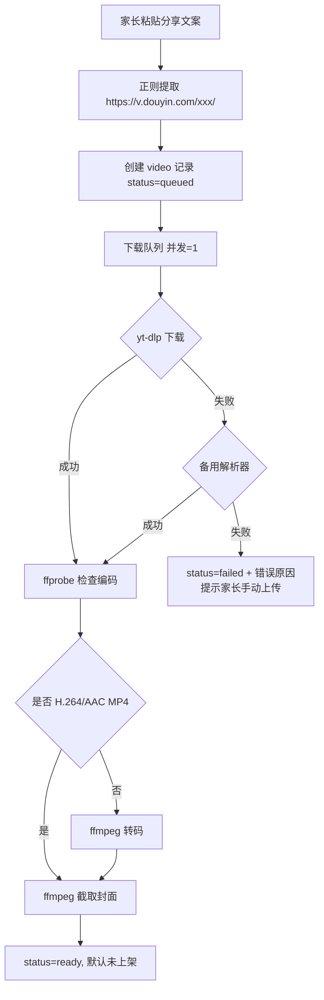
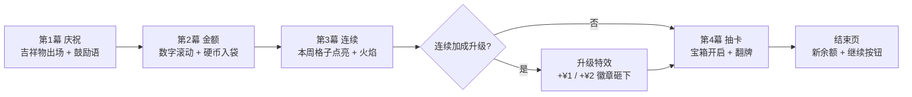

# 成长星球 · 技术设计（Tech Design）

对应文档：[项目目标](./01-goal.md)、[需求清单](./02-requirements.md)

---

## 1. 总体架构



- **一个仓库、一个服务、两个前端入口**：`/`（孩子端）与 `/admin`（家长后台），共用 API。
- 家庭规模（3~4 个用户）下选择最简单可靠的方案：**单进程 + SQLite + 本地文件存储**，用 Docker 部署。

## 2. 技术选型

| 层 | 选择 | 理由 |
|----|------|------|
| 前端框架 | React 18 + TypeScript + Vite | 生态成熟，动效库丰富 |
| PWA | `vite-plugin-pwa`（Workbox） | 生成 manifest 与 Service Worker，支持离线缓存 |
| 路由 | React Router | 孩子端与后台分别打包为两个入口 |
| 状态/请求 | TanStack Query + Zustand | 服务端状态与本地 UI 状态分离 |
| 样式 | Tailwind CSS | 快速做大按钮、响应式布局 |
| 动效 | Framer Motion（界面过渡）、Lottie（成套动画）、`canvas-confetti` / PixiJS（粒子） | 领奖与抽卡动效需要高帧率粒子效果 |
| 音效 | Howler.js | 兼容 iOS 的音频解锁 |
| 后台 UI | 同一技术栈 + 简单组件库（如 shadcn/ui） | 家长端追求清晰高效 |
| 后端 | Node.js 20 + Fastify + TypeScript | 轻量，前后端同语言共享类型 |
| ORM | Drizzle ORM（或 Prisma） | 类型安全，SQLite 支持好 |
| 数据库 | SQLite（WAL 模式） | 零运维，数据量极小；后续可平滑迁到 PostgreSQL |
| 定时任务 | `node-cron` | 游泳自动发放、每日任务生成 |
| 下载队列 | 进程内队列（`p-queue`）+ 数据库状态表 | 无需引入 Redis |
| 视频处理 | `yt-dlp` + `ffmpeg` | 抽取封面、必要时转码为 iPad 可播放的 H.264 MP4 |
| 部署 | Docker Compose + Caddy（自动 HTTPS） | PWA 与 Service Worker 要求 HTTPS |

### 仓库结构

```
growthPlanet/
├── apps/
│   ├── kid/          # 孩子端 PWA
│   ├── admin/        # 家长后台
│   └── server/       # API + 定时任务 + 下载器
├── packages/
│   └── shared/       # 共享类型、事件定义、常量
├── docs/
└── docker-compose.yml
```

使用 pnpm workspace 管理。

## 3. iPad 全屏（像 App 一样）

iOS Safari 只有在**从主屏幕启动**时才会去掉地址栏和工具栏，因此需要：

1. `manifest.webmanifest`：
   ```json
   {
     "name": "成长星球",
     "short_name": "成长星球",
     "display": "standalone",
     "orientation": "any",
     "start_url": "/",
     "scope": "/",
     "background_color": "#0b1026",
     "theme_color": "#0b1026",
     "icons": [{ "src": "/icons/512.png", "sizes": "512x512", "type": "image/png" }]
   }
   ```
2. `index.html` 中的 iOS 专用标签：
   ```html
   <meta name="apple-mobile-web-app-capable" content="yes">
   <meta name="mobile-web-app-capable" content="yes">
   <meta name="apple-mobile-web-app-status-bar-style" content="black-translucent">
   <meta name="viewport" content="width=device-width, initial-scale=1, viewport-fit=cover, user-scalable=no">
   <link rel="apple-touch-icon" href="/icons/180.png">
   <link rel="apple-touch-startup-image" href="/splash/ipad-xxx.png" media="...">
   ```
3. 样式适配安全区：`padding: env(safe-area-inset-*)`；禁用长按菜单与文字选中（`-webkit-touch-callout: none; user-select: none`）；禁用双击缩放与回弹（`overscroll-behavior: none`）。
4. 首次在 Safari 打开时检测 `navigator.standalone === false`，显示引导页："点击分享 → 添加到主屏幕"。
5. 所有外链被拦截；应用内导航使用前端路由，避免触发 Safari 打开新页面。
6. 建议家长开启 iPad「引导式访问」（设置 → 辅助功能），把孩子锁定在本应用内。

> 已知限制：iOS 的 PWA 存储可能在长期不用时被系统清理，因此**所有业务数据以服务端为准**，本地只做静态资源缓存和少量待发送事件。

### 3.1 联网守卫（断网即停）

应用必须联网才能使用，以保证行为数据完整：

- 监听 `online` / `offline` 事件，并每 10 秒向 `/api/ping` 发送心跳（`navigator.onLine` 在 iOS 上不可靠，需以心跳结果为准）。
- 连续 2 次心跳失败或收到 `offline` 事件 → 立即暂停并销毁正在播放的视频、显示全屏"网络断开"遮罩、禁止一切操作，记录 `network_lost` 事件到本地。
- 恢复后自动移除遮罩，补发 `network_lost` / `network_restored` 及期间少量事件。
- 视频播放地址为短期签名且服务端按心跳校验观看会话，即使前端被绕过，断网期间也无法继续获取视频数据。
- Service Worker 只缓存静态资源（JS/CSS/图片），**不缓存视频和任何 API 响应**。

## 4. 身份与权限

| 角色 | 入口 | 登录方式 | 凭证 |
|------|------|---------|------|
| 孩子 | `/`（PWA） | 用户名 + 密码 | 长期会话 Cookie（HttpOnly，30 天滚动续期） |
| 家长 | `/admin`（独立链接，手机浏览器） | 用户名 + 密码 | 会话 Cookie（HttpOnly） |

- 所有账号由家长在后台创建，`role` 字段标记身份（`parent` / `child`），孩子账号额外有称呼（如"儿子""女儿"）。系统首次启动时通过命令行创建第一个家长账号。
- 孩子端登录后在 iPad 上保持登录；可退出并切换到另一个孩子的账号。
- 孩子会话只拥有自身数据的读写权限；发币、确认等敏感操作只有家长或服务端定时任务可执行。
- 家长 API 统一挂在 `/api/admin/*`，中间件校验 `role=parent`；孩子账号即使知道 `/admin` 链接也无法登录后台。
- 密码 argon2 哈希；连续输错 5 次锁定 10 分钟。

## 5. 数据模型



### 主要表

**user**（账号）
`id, username, password_hash, role(parent|child), display_role(儿子|女儿|爸爸|妈妈...), status(active|disabled), failed_login_count, locked_until, created_by, created_at`

**child_profile**（孩子档案，`user.role=child` 时存在）
`user_id, nickname, avatar_id, background_id, frame_id, title_id, reward_fx_theme`

> 下文中的 `child_id` 即孩子账号的 `user.id`。

**task_definition**（任务模板，家长可配置）
`id, code(school_hw|houhai_hw|swim|vocab), name, need_parent_confirm, auto_complete, period_rule(JSON), default_deadline(可空), base_reward, streak_rule(JSON|null), enabled`

默认配置：

| code | period_rule | default_deadline | base_reward | streak_rule |
|------|-------------|------------------|-------------|-------------|
| `school_hw` | 周一~周四各一个周期；周五~周日合并为一个周期 | 19:30（合并周期取周日 19:30） | 3 | `{ "wed": 1, "fri": 2 }` |
| `houhai_hw` | 每天一个周期 | 无 | 2 | `{ "wed": 1, "fri": 2 }` |
| `swim` | 周一、周四 | 无（20:00 自动确认） | 2 | null |
| `vocab` | 占位 | — | — | — |

**task_instance**（任务周期实例，一个周期一条）
`id, child_id, task_def_id, period_start(date), period_end(date), week_start(周一日期), deadline_at(可空, 家长可按人按天修改), status, completed_at, completed_via(parent_click|kid_photo|auto), confirmed_at, confirmed_by, photo_paths, photo_hashes, qualified(bool), base_reward, streak_bonus, reward_amount`

- 学校作业周末周期：`period_start=周五, period_end=周日`，一条记录。
- `completed_at` 一律取**服务端时间**（北京时间）：家长点击时的时间，或孩子拍照提交时的时间；家长确认时可手动修改（写入操作日志）。
- `qualified` 判定：有 `deadline_at` 的任务要求 `completed_at <= deadline_at`；无截止时间的任务（厚海、游泳）完成即达标。
- 唯一索引 `(child_id, task_def_id, period_start)`，防止重复生成周期。

状态机：



`done` 时若 `qualified=true` 则按 6.2 节计算金额并生成 `reward_claim`；未达标的周期 `reward_amount=0`，并中断本周连续。

**reward_claim**（待领取奖励）
`id, child_id, source_type(task|other_income|set_bonus|perfect_week), source_id, amount, title, card_draws, status(unclaimed|claimed|revoked), created_at, claimed_at`
任务达标或家长记录"其他奖励"时生成；孩子点击领取时才入账并播放动效。这样把"家长确认"和"孩子领奖的仪式感"解耦。唯一索引 `(source_type, source_id)` 防止重复发放。

**ledger_entry**（账本，单位：分，只增不改）
`id, child_id, amount(+/-), balance_after, type(task_reward|other_income|other_expense|video_purchase|item_purchase|reversal|set_bonus), ref_type, ref_id, title, created_by, idempotency_key(唯一), created_at`
- 金额以整数星币存储；界面显示为「星币」。
- 余额 = 最后一条的 `balance_after`；写入在事务中串行执行，防止并发错账。
- **余额允许为负**：系统自动扣回（游泳）与家长记录的花费可以让余额变负；孩子主动消费（视频、装扮）要求 `余额 >= 价格`。
- 纠错只能追加记录（`reversal` 或家长的"其他奖励/花费"），不修改历史。

**parent_action_log**（家长操作日志）
`id, parent_id, action(complete_task|edit_completed_at|edit_deadline|mark_no_swim|other_income|other_expense|undo|...), target_type, target_id, before(JSON), after(JSON), created_at`

**card / child_card / card_draw**（集卡）
`card: id, series_id, name, image, rarity(common|rare|epic|legendary), weight`
`child_card: child_id, card_id, count, first_obtained_at`
`card_draw: id, child_id, reward_claim_id, card_id, rarity, pity_counter, created_at`

**item / child_item**（装扮）
`item: id, type(avatar|background|frame|title|pet|fx_theme), name, asset, price, unlock_rule(JSON)`

**video / video_purchase / video_watch**
`video: id, source_url, share_text, douyin_id, title, cover_path, file_path, duration_seconds(ffprobe 探测), status(queued|downloading|ready|failed), error, visible_child_ids, published, created_at`
`video_purchase: id, child_id, video_id, purchase_date, daily_index(当天第几个), price, max_plays(=2), plays_used, ledger_entry_id, created_at`
唯一索引 `(child_id, purchase_date, daily_index)`，保证"当天第几个"在并发下也不会重复。
`video_watch: id, purchase_id, child_id, video_id, play_no(1|2), started_at, last_heartbeat_at, ended_at, watched_seconds, completed, end_reason(finished|closed|network_lost)`

**event_log**（行为日志）
`id, client_event_id(UUID, 去重), child_id, device_id, session_id, type, page, props(JSON), client_ts, server_ts`

**setting**（键值配置）
`key, value(JSON)`：任务奖励与连续加成（存在 `task_definition`）、视频计价、游泳日与自动确认时间（默认 20:00）、时区（`Asia/Shanghai`）等。

视频计价默认配置：

```json
{ "video_pricing": { "base": 2, "step": 1, "long_threshold_seconds": 600, "long_extra": 1 } }
```

**expense_template**（家长常用收支模板，P1）
`id, kind(income|expense), title, amount`

## 6. 核心流程

### 6.1 作业完成与确认

**主流程（家长在家）**：孩子线下告诉家长 → 家长手机打开后台首页"今日作业"面板 → 点击对应孩子的作业按钮 → 服务端以当前时间为 `completed_at`，判定是否达标，达标则按 6.2 节计算金额并生成 `reward_claim`。

"今日作业"面板同时显示每个孩子当天学校作业的截止时间（默认 19:30），点击即可修改。

**备用流程（家长不在家）**：



关键点：**抽卡结果由服务端决定**，前端只负责播放，防止刷卡。

### 6.2 作业奖励计算（含连续加成）

```ts
function calcReward(def: TaskDefinition, period: TaskInstance, weekPeriods: TaskInstance[]): number {
  if (!period.qualified) return 0;
  let bonus = 0;
  if (def.streakRule) {
    const earlier = weekPeriods.filter(p => p.periodStart < period.periodStart);
    const unbroken = earlier.every(p => p.qualified);
    const weekday = dayOfWeek(period.periodStart); // 1=周一 ... 7=周日
    if (unbroken) {
      if (weekday >= 5) bonus = def.streakRule.fri;      // 周五及以后 +2
      else if (weekday >= 3) bonus = def.streakRule.wed; // 周三、周四 +1
    }
  }
  return def.baseReward + bonus;
}
```

- 连续以**自然周（周一至周日）**为单位，每周一重新计算；学校作业和厚海英语分别独立计算。
- 前面任一周期未达标（包括尚未完成的），后面周期都没有加成。
- **补发差额**：家长事后把较早的周期补标为达标（如忘记点击、修改完成时间）时，服务端重新计算本周后续已达标周期的金额，差额作为新的 `reward_claim`（标题如"连续奖励补发"）发放；不会收回或改写已发放的记录。
- 周期结束仍未完成的 → 定时任务置为 `missed`。厚海英语允许家长在周期结束后的第二天内补标（家长纠错入口，写操作日志）。

满额时每周：学校作业 3+3+4+4+5 = 19 星币，厚海英语 2+2+3+3+4+4+4 = 22 星币，游泳 4 星币。

### 6.3 游泳自动发放

- 每日 00:05 定时任务：为当天开始的周期生成 `task_instance`（学校作业在周五生成周末合并周期；游泳仅在配置的周几生成）。
- 每日 20:00（可配置）：游泳实例若仍为 `pending`，自动置为 `done`（`completed_via=auto`, `qualified=true`）并生成 2 星币的 `reward_claim`。
- 家长标记"没去"：
  - 20:00 前 → 实例置为 `skipped`，不会发放；
  - 20:00 后且奖励未领取 → `reward_claim` 置为 `revoked`；
  - 20:00 后且已领取 → 追加一条 -2 星币的 `reversal` 记录，余额可以因此为负。

### 6.4 背单词（自愿）

本期只占位：任务模板与孩子端卡片入口存在，玩法与奖励规则【待细化】。

### 6.5 家长记录其他奖励 / 花费

`POST /api/admin/ledger/other`：`{ childIds[], kind: income|expense, title, amount, idempotencyKey }`

- `income` → 为每个孩子生成 `reward_claim(source_type=other_income)`，孩子领取时播放领奖动效。
- `expense` → 直接写 `ledger_entry(type=other_expense)`，允许余额变负；孩子端下次打开时弹出"爸爸/妈妈记录了一笔花费：买零食 -5 星币"。
- 写入 `parent_action_log`。

### 6.6 观看视频（递增计价；第 2 遍免费，第 3 遍起重新购买）

**价格计算**（服务端）：

```ts
function videoPrice(dailyIndex: number, durationSeconds: number, cfg: VideoPricing): number {
  const base = cfg.base + (dailyIndex - 1) * cfg.step;                    // 第 1 个 2 星币，第 2 个 3 星币 ...
  const extra = durationSeconds > cfg.longThresholdSeconds ? cfg.longExtra : 0; // 超过 10 分钟 +1 星币
  return base + extra;
}
```

- `dailyIndex` = 当天（北京时间）已购买数 + 1；同一次购买的第 2 遍不产生新购买、不计入序号。`plays_used` 达到 2 之后，再次播放视为新购买并占用新序号。
- 孩子点视频前先调用 `GET /api/videos/:id/quote` 获取报价（"这是今天第 3 个，需要 4 星币"），确认后再播放。
- 每次领奖默认抽 1 张卡。若本次达标使本周学校作业、厚海、游泳全部 `qualified`，则 `card_draws = 2`。

**播放流程**：

1. 孩子确认 → `POST /api/videos/:id/play`（带 `idempotencyKey` 与报价金额）：
   - 若存在该视频 `plays_used < 2` 的购买记录 → 使用该记录，`plays_used + 1`，不收费；
   - 否则在事务中重新计算价格（若与报价不一致则返回新报价让孩子重新确认）→ 校验 `余额 >= 价格` → 扣费并新建 `video_purchase`，`plays_used = 1`；
   - 以上在同一数据库事务中完成；创建 `video_watch`（`play_no` = 第几遍）。
2. 服务端返回绑定本次 `video_watch` 的签名播放地址 `/media/videos/:id.mp4?w=<watch_id>&sig=...`，有效期短（如 60 秒），由心跳续期。
3. 播放中每 10 秒上报心跳 `POST /api/watch/:id/heartbeat`，服务端更新 `watched_seconds` 并续期签名；超过 30 秒无心跳视为中断（`end_reason=network_lost`），签名失效。
4. "开始播放"即计为一遍（刷新页面、退出重进都不会重置次数）；第 2 遍免费；第 3 遍起按新购买计价。

> 若后续金钱体系改为"按分钟计费"，在心跳中按分钟扣费即可，表结构已预留。

## 7. 抖音视频导入

### 7.1 流程



### 7.2 链接提取

```ts
const DOUYIN_URL = /https?:\/\/v\.douyin\.com\/[A-Za-z0-9_-]+\/?/;
```
示例文案 `1.53 复制打开抖音，看看【孩子的一棠课的作品】《王戎不取道旁李》... https://v.douyin.com/z735N6lkOeM/ 12/17 ...` 可提取出 `https://v.douyin.com/z735N6lkOeM/`；同时从 `【...】` 与 `《...》` 中提取作者与标题作为默认标题，家长可修改。

### 7.3 下载器（策略模式，可替换）

```ts
interface VideoDownloader {
  name: string;
  download(url: string, outDir: string): Promise<{ filePath: string; title?: string; coverUrl?: string; douyinId?: string }>;
}
```

1. **主策略：无头浏览器**（`playwright-core` + Chromium）。以桌面 UA 打开短链，等待页面自己发出的 `/aweme/v1/web/aweme/detail/` 响应（签名和 Cookie 由页面生成），从 `video.bit_rate` 中选不超过 720p 的最高码率 H.264 地址，带 `Referer: https://www.douyin.com/` 直接下载。服务器需执行 `npx playwright install --with-deps chromium`，或用 `CHROMIUM_PATH` 指定浏览器。
2. **备用策略：`yt-dlp`**。2026-10 实测不带 Cookie 时抖音返回 403（`Fresh cookies are needed`），仅作为备用。移动端分享页已不再内嵌视频 JSON，旧的自研解析方式失效。
3. **兜底：手机相册上传**。家长先在抖音"保存到相册"，再在后台用 `<input type="file" accept="video/*">` 从相册选择上传。手机视频可能较大（几十到几百 MB），采用**分片上传**（每片 5MB，支持断点续传与进度条），服务端合并后进入同样的 ffprobe/转码/截封面流程。iPhone 拍摄的 HEVC/MOV 会转码为 H.264 MP4。

**手机端交互**：后台"添加视频"页只有一个大输入框和"粘贴"按钮（调用 `navigator.clipboard.readText()`，失败则让家长长按粘贴），以及一个"从相册上传"按钮。

> 抖音的接口和反爬策略会不定期变化，下载失败是预期内的情况，所以兜底流程是 P0。下载的视频仅用于家庭内部观看，不对外分发。

### 7.4 媒体服务

- 视频文件存于 `/data/media/videos/`，通过 Fastify 静态服务提供，**必须支持 HTTP Range 请求**（iOS Safari 播放 MP4 依赖 Range）。
- `<video playsinline>` 内嵌播放，自定义控件，隐藏下载/画中画按钮。

## 8. 行为记录（埋点）

### 8.1 客户端 SDK

```ts
track(type: EventType, props?: Record<string, unknown>)
```

- 每条事件生成 `client_event_id`（UUID）与客户端时间戳，写入 IndexedDB 队列。
- 每 5 秒或累计 20 条批量 `POST /api/events`；页面 `visibilitychange → hidden` 时使用 `navigator.sendBeacon` 立即发送。
- 断网时（此时应用已被联网守卫锁定，见 3.1）少量事件保留在队列中，联网后补发；服务端按 `client_event_id` 去重。

### 8.2 事件清单（`packages/shared/events.ts` 统一定义）

| 类别 | 事件 |
|------|------|
| 会话 | `app_open`, `app_hidden`, `app_visible`, `login`, `login_failed`, `logout` |
| 网络 | `network_lost`, `network_restored` |
| 页面 | `page_view`（含页面名、停留时长） |
| 任务 | `task_submit_photo`, `vocab_open` |
| 奖励 | `reward_view`, `reward_claim`, `card_draw`, `card_album_view` |
| 个性化 | `nickname_change`, `avatar_change`, `background_change`, `item_purchase`, `item_equip`, `fx_theme_change` |
| 视频 | `video_list_view`, `video_purchase`, `video_play`, `video_pause`, `video_progress`, `video_end`, `video_replay_exhausted` |
| 钱包 | `wallet_view`, `ledger_view` |

另外，服务端在发生关键业务动作（入账、家长点击完成、修改完成时间、冲正、视频扣费与计次）时也写入 `event_log`（`source=server`），保证即使客户端事件丢失，关键数据仍完整。

### 8.3 家长后台查询

- 行为流水：按 `child_id + server_ts` 建索引，分页查询。
- 今日概览/趋势：直接 SQL 聚合（数据量小，无需数仓）；使用时长由 `app_visible`→`app_hidden` 区间累加得出。

## 9. 领奖动效与集卡

### 9.1 设计思路：对标多邻国并超越

借鉴多邻国让人"上瘾"的设计手法（不使用其角色、素材与音效，全部原创）：

| 多邻国的做法 | 成长星球的对应设计 |
|-------------|------------------|
| 完成课程后的全屏庆祝页，吉祥物跳舞 | 领奖时吉祥物伙伴出场庆祝，说出带孩子昵称的鼓励语 |
| XP 数字滚动、清脆的音效节奏 | 金额从 0 滚动到 ¥X，每跳一下一个音阶，硬币逐个飞入钱包 |
| 连续打卡火焰与周历 | 本周进度条：周一到周日 7 个格子依次点亮，火焰随连续天数变大；明确显示"明天达标 +¥1" |
| 宝箱、宝石奖励 | 宝箱开启 + 抽卡翻牌，稀有度越高越华丽 |
| 里程碑庆祝（7 天、30 天） | 连续加成升级（周三 +¥1、周五 +¥2）与"完美一周"大庆祝 |

**超越的地方**：

1. **个人专属**：每个孩子有自己选的吉祥物伙伴和动效主题，不是千人一面。
2. **真金白银**：奖励是能花的零花钱，连续加成直接体现为金额增加，因果关系更直观。
3. **收集养成**：每次领奖都抽卡，卡册收集与系列奖励提供长期目标。
4. **家人参与**：家长可以给某笔奖励附一句话，领奖时吉祥物"念出来"（P1）。
5. **断连的温和处理**：连续中断时不做惩罚式动画，而是吉祥物鼓励"下周一重新开始"。

### 9.2 分幕编排

领奖是一个按顺序播放的"剧本"，每一幕都可以点击跳到下一幕：



服务端在领取接口中返回剧本所需的全部数据：

```ts
interface ClaimResult {
  amount: number;            // 分
  breakdown: { base: number; streakBonus: number };
  newBalance: number;
  week: { day: 1|2|3|4|5|6|7; status: 'qualified'|'missed'|'pending'|'future' }[];
  streakLevelUp?: 'wed' | 'fri';
  perfectWeek?: boolean;
  cards: Card[];
  message?: string;          // 家长附言
}
```

多个奖励同时待领取时，合并成一次"大宝箱"：先逐条快速滚动金额，最后统一播放连续进度与抽卡。

### 9.3 动效主题

每套主题是一个独立模块，实现统一接口：

```ts
interface RewardFxTheme {
  id: string;            // 'rocket' | 'magic' | 'ocean' ...
  mascot: LottieAsset;   // 吉祥物动画（出场、庆祝、鼓励）
  playCelebrate(nickname: string, message?: string): Promise<void>;
  playCoinReward(amount: number, target: DOMRect): Promise<void>;
  playStreak(week: WeekStatus[], levelUp?: 'wed' | 'fri'): Promise<void>;
  playCardReveal(card: Card): Promise<void>; // 按稀有度分级
  sounds: Record<'open' | 'tick' | 'coin' | 'levelUp' | 'rare' | 'legendary', string>;
}
```

首版 3 套：
- **火箭发射**：宝箱震动 → 火箭冲出 → 硬币如尾焰般飞入钱包 → 数字滚动；连续火焰表现为火箭推进器
- **星光魔法**：魔法阵展开 → 花瓣与星光粒子 → 硬币旋转落入钱包；连续火焰表现为魔法星环
- **深海宝藏**：气泡上浮 → 贝壳打开 → 珍珠化作硬币；连续火焰表现为发光水母

稀有度分级：普通（翻牌）→ 稀有（蓝光）→ 史诗（紫光 + 震屏）→ 传说（金光 + 全屏特效 + 专属音效）。

实现：Lottie 负责吉祥物和宝箱等成套动画，PixiJS 负责粒子，Framer Motion 负责卡片 3D 翻转与数字滚动；音频在首次用户点击时解锁（iOS 限制自动播放）。iPad 的 Safari 不支持网页震动，"震屏"用画面抖动表现。性能目标：iPad 上 60fps，完整剧本 ≤ 8 秒，每幕可跳过。

美术制作：吉祥物与卡牌使用 AI 生成后人工挑选或自绘，动画可用 Lottie 社区的免费可商用素材二次加工，或在 Rive/After Effects 中制作。

### 9.4 抽卡算法（服务端）

- 按稀有度权重（可配置，如 70/22/7/1）先抽稀有度，再在该稀有度内按 `weight` 抽具体卡。
- 保底：每个孩子维护 `pity_counter`，连续 N 次无稀有及以上时强制提升。
- 集齐系列时自动发放系列奖励（`reward_claim`，类型 `set_bonus`）。
- 卡牌美术使用原创素材（AI 生成后人工挑选或自绘）。

## 10. API 概览

### 孩子端 `/api`
| 方法 | 路径 | 说明 |
|------|------|------|
| POST | `/auth/login`, `/auth/logout` | 用户名密码登录/退出（仅 `role=child`） |
| GET | `/ping` | 联网心跳 |
| GET/PATCH | `/me` | 档案、装扮 |
| GET | `/tasks/today` | 今日任务 |
| POST | `/tasks/:id/submit` | 拍照提交作业（multipart，必带照片） |
| GET | `/rewards/unclaimed` | 待领取奖励 |
| POST | `/rewards/:id/claim` | 领取（返回金额、卡牌） |
| GET | `/wallet`, `/wallet/ledger` | 余额与明细 |
| GET | `/cards/album` | 卡册 |
| GET | `/items`, POST `/items/:id/buy`, POST `/items/:id/equip` | 装扮商店 |
| GET | `/videos` | 可见视频列表 |
| GET | `/videos/:id/quote` | 报价（今天第几个、价格、是否还有免费的第 2 遍） |
| POST | `/videos/:id/play` | 开始播放（必要时扣费，计次，返回签名地址） |
| POST | `/watch/:id/heartbeat`, `/watch/:id/end` | 观看心跳与结束 |
| POST | `/events` | 批量上报行为 |

### 家长端 `/api/admin`
| 方法 | 路径 | 说明 |
|------|------|------|
| POST | `/auth/login`, `/auth/logout` | 家长登录/退出（仅 `role=parent`） |
| GET | `/today` | 今日作业面板（每个孩子 × 每类任务的状态） |
| POST | `/tasks/:id/complete` | 标记完成 / 确认拍照提交（可传修改后的完成时间） |
| PATCH | `/tasks/:id/deadline` | 修改某孩子某周期的截止时间 |
| POST | `/tasks/:id/undo` | 撤销误点（P1） |
| GET | `/approvals` | 孩子拍照提交的待确认列表 |
| POST | `/tasks/:id/skip` | 标记没去游泳 |
| GET/POST/PATCH/DELETE | `/videos` | 视频管理；POST 接收分享文案 |
| POST | `/uploads`, PUT `/uploads/:id/chunks/:n`, POST `/uploads/:id/finish` | 相册视频分片上传 |
| POST | `/videos/:id/retry` | 重新下载 |
| GET/POST/PATCH | `/users` | 账号管理（创建、标记身份、重置密码、停用） |
| GET | `/events` | 行为流水（筛选、分页） |
| GET | `/stats/today`, `/stats/trend` | 概览与趋势 |
| GET | `/ledger` | 账本查看 |
| POST | `/ledger/other` | 记录其他奖励 / 花费（可多选孩子） |
| GET/POST/DELETE | `/expense-templates` | 常用收支模板（P1） |
| GET | `/action-logs` | 家长操作日志 |
| GET/PUT | `/settings` | 规则配置 |

## 11. 部署（海外云服务器）

已确定使用海外云服务器，无需 ICP 备案。

**机房选择**：优先选对中国大陆线路好的机房（香港 > 新加坡 / 日本东京），并选择带 CN2 GIA 等优化线路的套餐，否则晚高峰 iPad 看视频可能卡顿。

**配置建议**：2 核 4G、带宽 ≥ 10Mbps（或按流量计费）、100GB 数据盘。

**海外服务器的两个风险与对策**：

| 风险 | 对策 |
|------|------|
| 抖音对海外 IP 限流或要求验证，下载失败率高 | 购买服务器后**第一件事**就是用 `yt-dlp` 实测几条链接；失败时家长从手机相册上传兜底（已是 P0）。如长期失败率高，可考虑在家里电脑上跑一个小的"下载助手"，下载后推送到服务器 |
| 跨境访问视频卡顿 | 视频统一转码为 720p、码率约 1.5Mbps 的 H.264；开启 HTTP Range 与浏览器缓存；后续视情况加 CDN |

**时区**：服务器系统时区可以是 UTC，但业务代码中"今天"、截止时间、20:00 自动确认、视频每日计数一律按 `Asia/Shanghai` 计算。

`docker-compose.yml`：
- `app`：Node 服务（内含 `yt-dlp`、`ffmpeg`）
- `caddy`：反向代理 + 自动 HTTPS
- 数据卷：`/data/db`（SQLite）、`/data/media`（视频、封面、照片）
- 每日备份 SQLite 与媒体目录（`litestream` 或简单的 cron 拷贝）。

## 12. 安全与隐私

- 所有账号密码使用 argon2 哈希，连续错误 5 次锁定 10 分钟；服务暴露在公网，登录接口加限流。
- 照片、行为数据只存储在自有服务器，不接入第三方统计服务。

### 12.1 防刷细则（首版，发现漏洞再补）

| 漏洞方向 | 措施 |
|---------|------|
| 前端伪造金额 / 抽卡结果 | 收入、扣费、视频价格、连续加成、抽卡全部在服务端计算，客户端提交的金额字段一律忽略（视频报价仅用于比对） |
| 重复发放 / 重复领奖 | `reward_claim` 唯一索引 `(source_type, source_id)`；领取使用条件更新 `UPDATE ... WHERE status='unclaimed'`，影响行数为 0 即拒绝 |
| 连点、重发、多页面并发 | 所有涉及钱的写接口要求 `idempotencyKey`（`ledger_entry` 上唯一索引）；账本写入在事务中串行执行 |
| 视频"当天第几个"被并发绕过 | `video_purchase` 唯一索引 `(child_id, purchase_date, daily_index)`，冲突时重试计算 |
| 改 iPad 时间骗"达标" | `completed_at` 与"今天"的划分只用服务端北京时间 |
| 拍旧照片 / 网图冒充作业 | 前端使用 `<input type="file" accept="image/*" capture="environment">` 直接调相机；服务端计算感知哈希（pHash），与该孩子历史照片相似时在家长确认页标红；拍照提交必须家长确认 |
| 刷新页面重置视频次数 | 播放次数在服务端 `video_purchase.plays_used` 计数，"开始播放"即计次 |
| 拿视频链接在 Safari 反复看 | 播放地址绑定 `video_watch`、60 秒签名、依赖心跳续期；`end` 后立即失效 |
| 短视频冒充长视频（或反之） | 时长以服务端 ffprobe 探测为准 |
| 孩子登录家长后台 | `/api/admin/*` 校验 `role=parent`；家长账号新设备登录时在后台提醒；登录记录设备、IP、时间 |
| 孩子用兄弟姐妹账号花对方的钱 | 账号独立密码；登录记录可查；同一设备切换账号写入行为日志 |
| 暴力猜密码 | 失败 5 次锁定 10 分钟；登录接口按 IP 限流 |
| 家长误操作 / 事后核对 | 家长所有操作写 `parent_action_log`，含修改前后值 |
| 异常行为（P2） | 定时扫描：短时大量请求、同账号多设备同时在线、观看心跳异常，结果在家长后台提醒 |

## 13. 开发里程碑

| 阶段 | 内容 | 产出 |
|------|------|------|
| M0 准备 | 购买海外云服务器与域名；**实测 yt-dlp 下载抖音**；配置 HTTPS | 可用的 HTTPS 域名 + 抖音下载可行性结论 |
| M1 基础框架 | monorepo、PWA 全屏、账号体系（家长建号/双端登录）、联网守卫、数据库与埋点 SDK | iPad 上能全屏登录并记录行为 |
| M2 学习与钱包 | 任务周期（含周末合并）、家长一键完成与改截止时间、孩子拍照提交、达标判定与连续加成、游泳 20:00 自动发放、家长记录其他收支、账本、背单词占位、待领取奖励（简单动效） | 完整"赚钱"闭环 |
| M3 娱乐 | 手机粘贴抖音链接导入、相册分片上传、视频递增计价与 2 遍限制、观看心跳统计 | 完整"花钱"闭环 |
| M4 情绪价值 | 多邻国式分幕领奖（3 套主题）、连续加成升级动效、抽卡与卡册、昵称/头像/背景、装扮商店 | 吸引力与个性化 |
| M5 后台完善 | 今日概览、趋势图、行为流水筛选、操作日志、规则配置 | 家长全面可见 |

## 14. 待细化 / 开放问题

1. 背单词玩法与奖励。
2. 后续收费装扮的价格。
3. 发现新的防刷漏洞时补充 12.1 节。
